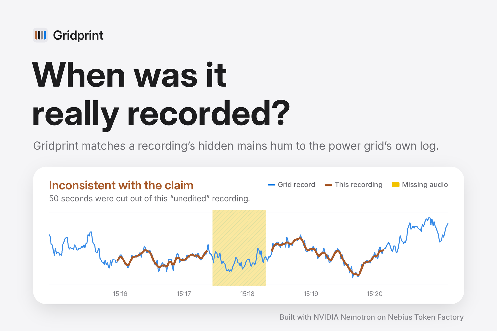

# Gridprint

**When was it really recorded?**



Every plugged-in room hums faintly at the power grid's frequency. In Great Britain that's about 50 Hz, but never exactly: it drifts by a few hundredths of a hertz every second as demand rises and falls. The drift is identical across the whole country, and the grid operator, NESO, publishes it second by second. Microphones record the hum, even when you can't hear it.

Gridprint reads that hum and matches it against the grid's record. That answers three questions about a recording:

- **When was it really made?** Often to the second, found by searching a month of grid data.
- **Was it edited?** Gridprint finds cuts and measures how many seconds are missing.
- **Where could it have been made?** A 60 Hz hum means a 60 Hz grid, such as North America's, not Britain's.

An agent built on NVIDIA Nemotron, running on Nebius Token Factory, runs the investigation and writes a plain-English verdict: consistent with the claim, inconsistent, or inconclusive. When there's no hum to work with, it says so rather than guessing.

## Quick start

You need Python 3.10 or newer. ffmpeg is optional on your own computer: it's only needed for MP3, M4A, video files and in-browser recordings. The online version includes it.

```bash
pip install -r requirements.txt
python scripts/build_reference.py --months 2025-01     # real NESO grid data (one month)
python scripts/make_examples.py                        # five demo cases, rebuilt from that data
python server.py                                       # then open http://127.0.0.1:7860
```

If the automatic download fails, download the month's CSV yourself from the [NESO data portal](https://www.neso.energy/data-portal/system-frequency-data), then run `python scripts/build_reference.py --csv path/to/file.csv`.

To switch the AI agent on, set your keys before starting the server:

```bash
export NEBIUS_API_KEY=...      # Windows PowerShell: $env:NEBIUS_API_KEY="..."
export TAVILY_API_KEY=...      # optional: lets the agent look up when an event in a claim happened
```

Without a key, Gridprint still runs every measurement and writes its report from a built-in template.

## How it works

1. **Extract the hum** (`gridprint/enf.py`). The audio is reduced to 1 kHz. Every second, the spectrum is zoomed in on the 50, 100 and 150 Hz harmonics (chirp-z transform), and the peak is refined by interpolation. The harmonics are combined, weighted by signal-to-noise, because phones filter out 50 Hz and the higher harmonics often carry the signal.
2. **Match it to the grid** (`gridprint/match.py`). The hum slides along a month of one-second grid data using overlap-add convolution. Each match is judged against every other alignment, then corrected for the look-elsewhere effect (searching a month gives chance thousands of tries). The result is a false-match probability, shown as plain odds.
3. **Check for edits** (`gridprint/enf.py`, `gridprint/forensics.py`). There are two independent methods:
   - **Phase jumps.** A cut makes the hum's phase jump, and it only counts when several harmonics agree.
   - **Timeline placement.** Each part of the recording is placed on the grid timeline separately. Parts that don't join up reveal missing audio, and a change-point scan measures how much.
4. **Investigate and explain** (`gridprint/agent.py`). Nemotron calls these tools through Nebius Token Factory, using OpenAI-compatible tool calling. It also uses Tavily to look up when an event named in a claim happened. It tests the claimed time first, widens the search if the claim fails, and writes the report. The model never touches the audio, and every number comes from tested code.
5. **Show the evidence** (`server.py`, `web/`). A FastAPI server streams each step to the browser as it happens. The front end is plain HTML, CSS and JavaScript, with light and dark modes and no build step. Every report records the file's SHA-256 fingerprint, the data used and the searches run, so another analyst can check the work.

## Deploying (free)

The demo runs on a free Hugging Face Space:

1. Create a new Space with **Docker** as the SDK and **CPU basic (free)** hardware.
2. Upload this repository. The header at the top of this file configures the Space.
3. Under **Settings → Variables and secrets**, add `NEBIUS_API_KEY` and `TAVILY_API_KEY` as **secrets**.

The same container runs anywhere Docker runs:

```bash
docker build -t gridprint . && docker run -p 7860:7860 -e NEBIUS_API_KEY=... gridprint
```

### Settings

| Variable | Default | What it does |
|---|---|---|
| `NEBIUS_API_KEY` | none | Switches on the Nemotron agent |
| `TAVILY_API_KEY` | none | Lets the agent search the web for when events happened |
| `GRIDPRINT_MODEL` | `nvidia/NVIDIA-Nemotron-3-Nano-30B-A3B` | Which Nemotron model to use |
| `GRIDPRINT_AI_DAILY_LIMIT` | `40` | Most AI-written reports per day, which protects your credits |
| `GRIDPRINT_AI_PER_VISITOR_PER_HOUR` | `6` | Most AI-written reports per visitor per hour |
| `GRIDPRINT_MAX_CONCURRENT` | `2` | How many analyses run at once |

Past either AI limit, the analysis still runs in full; only the written report switches to the template.

## Testing

```bash
python -m pytest -q                         # 12 tests: physics, statistics, server, security, messy data
python scripts/evaluate.py --trials 40      # accuracy on random recordings hidden in the grid data
```

The five demo cases are checked when they're built, so the walkthrough shows each feature clearly. `evaluate.py` measures accuracy on random, unchecked trials.

## Limits, stated plainly

- Gridprint needs mains hum. Battery devices outdoors, strong noise suppression and heavy compression can remove it. **Missing hum is not evidence of fakery.**
- Short recordings (under about 2 minutes) may not be unique within a month of data. The odds of a coincidence say so honestly.
- A skilled forger could add an artificial hum, but matching it to the real grid record second by second is much harder.
- The demo cases are synthesised: real grid frequency hidden in speech-band noise, which is the standard way ENF methods are tested. Real field recordings vary more.
- Gridprint is an investigative aid, not an accredited forensic examination.

## Data and licence

- **Grid frequency:** NESO Data Portal, under the NESO Open Data Licence v1.0. *Supported by National Energy SO Open Data.* Gridprint is not endorsed by NESO.
- **Code:** MIT licence (see `LICENSE`).
